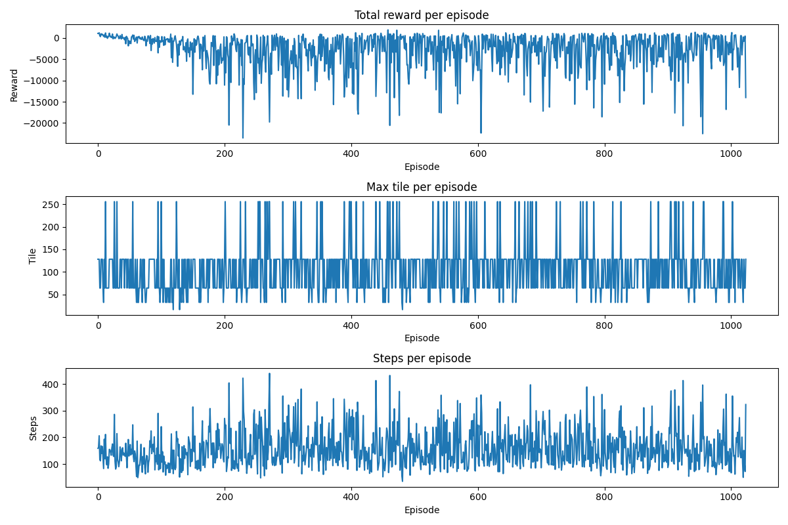

## 2048 Agent with Reinforcement Learning

The goal of the project is to build an agent that learns to play the game 2048 using Reinforcement Learning specifically a Deep Q-Network.
The idea is simple: the agent interacts with the game, receives rewards for good moves (like merging tiles, or keeping the board monotonous) and penalties for bad ones (not moving at all), and gradually learns a policy that leads to bigger tiles and longer survival.

The point also is to not use any static algorithms or heuristics, just pure Machine learning with the esitmation of positions and state evulation

The trained network didn't approch the 2048 tile initially, in both tiny `(16, 8)` and medium `(128, 64)` layer variants.
Changing of epsilon-greedyness (eps_decay from `0.995` to `0.99` and `eps_min` to `0.05` from `0.1`) din't improve the situantion,  and increasing penalty from 1 to 100 either. The NN is still 'hitting thw wall', picking steps that do not change the state.

I found a similiar project using 2D convolution layers, instead of linear with flatten vectorized representation: https://github.com/YangRui2015/2048_env
But they have got the same problem, and the meaningful improvements are only visible on 40'000+ traning episodes and wise DQN-specific technics, which I don't have enough resources for.

